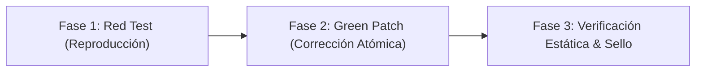

# CyberAudit Auto-Fix — TDD Remediation & Defect Repair Engine

*Automated, verified, regression-free remediation for findings discovered across all 8 CyberAudit engineering pillars.*

---

## 1. El Protocolo de Reparación TDD en 3 Fases (Chip Huyen / Dave Farley)

Cada hallazgo reportado por CyberAudit se repara bajo un contrato formal de 3 fases:



### Fase 1 — Red Test (Reproducción del Vector Vulnerable)
* Antes de modificar una sola línea de código productivo, crea una prueba unitaria o de integración mínima que demuestre el fallo exacto.
* La prueba **debe fallar** en rojo confirmando:
  - Inyección SQL / Comando / SSRF con payload de prueba.
  - Escritura síncrona no atómica que se corrompe ante corte forzado.
  - Fuga de memoria / listeners de eventos huérfanos.
  - Llamada HTTP saliente sin timeout explícito.
  - Violación de límite de capa (UI importando cliente ORM/DB directamente).

### Fase 2 — Green Patch (Corrección Defensiva Atómica)
* Aplica el parche mínimo defensivo en el archivo afectado (<150 líneas modificadas).
* Principios de diseño obligatorio:
  - **Inyecciones:** Consultas parametrizadas o listas blancas de binarios sin operadores shell.
  - **Persistencia:** Escritura atómica vía archivo temporal y rename atómico a nivel de OS.
  - **Concurrencia:** Límites de timeout explícitos en llamadas de red y manejo de transacciones.
  - **Arquitectura:** Inversión de dependencias y servicios desacoplados.
* Ejecuta la suite de pruebas local (`npm test`, `pytest`, `cargo test`) hasta que el test de reproducción pase en **VERDE**.

### Fase 3 — Verificación Estática & Sello Criptográfico
* Vuelve a ejecutar el escáner específico de CyberAudit sobre el archivo corregido:
  ```bash
  cyberaudit audit <archivo_o_directorio>
  ```
* Confirma que el `Finding ID` ya no aparece en el reporte y que la suite completa del proyecto permanece en verde (0 regresiones).
* Emite el sello criptográfico inmutable `SELLO-CYBERAUDIT-VERIFICADO` con el hash SHA-256 del commit y el resultado.

---

## 2. Contrato de Emisión: where / why / repro / fix

Al presentar la reparación al usuario, estructura la respuesta obligatoriamente con el formato:

* **`where`:** Ruta exacta del archivo y número de línea (`src/repository/userRepo.js:42`).
* **`why`:** Invariante violado y riesgo concreto (ej: *CWE-89 SQL Injection debido a interpolación directa en la consulta*).
* **`repro`:** Código del test unitario rojo que reproduce la falla.
* **`fix`:** Parche atómico defensivo aplicado con tipado seguro y contratos validados.
* **`status`:** `RESOLVED` y validado por el escáner nativo.
